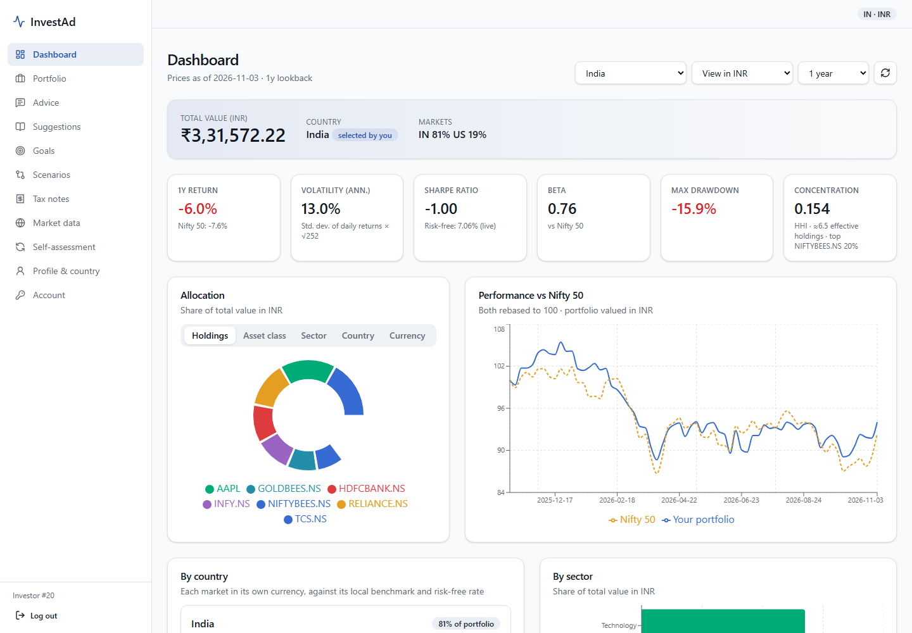
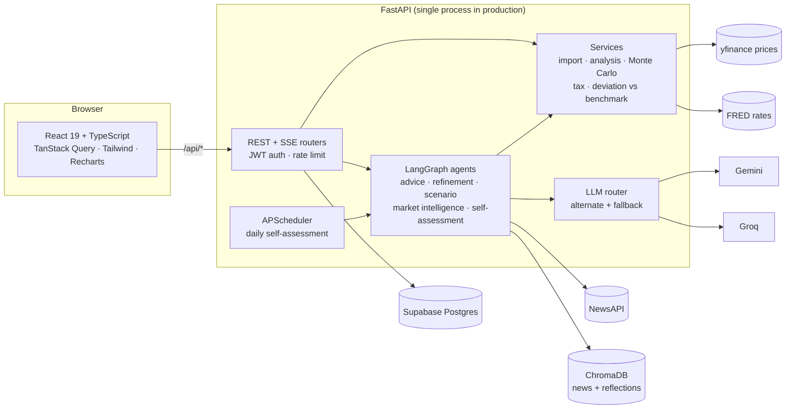
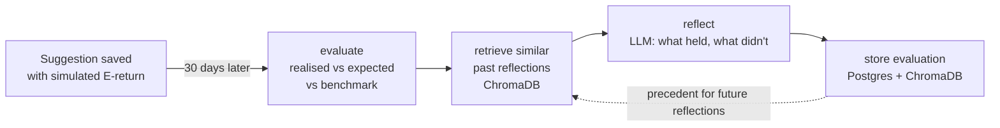
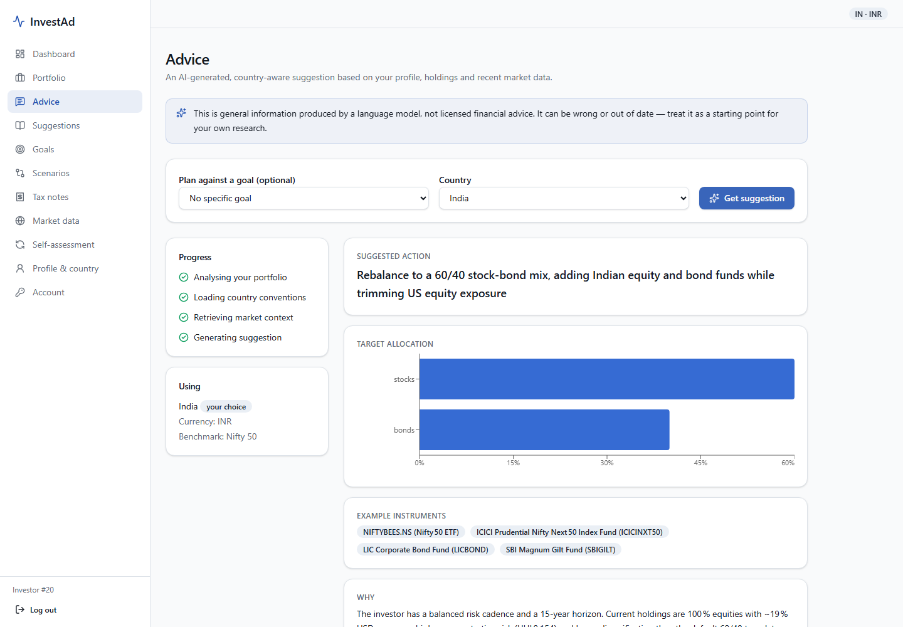
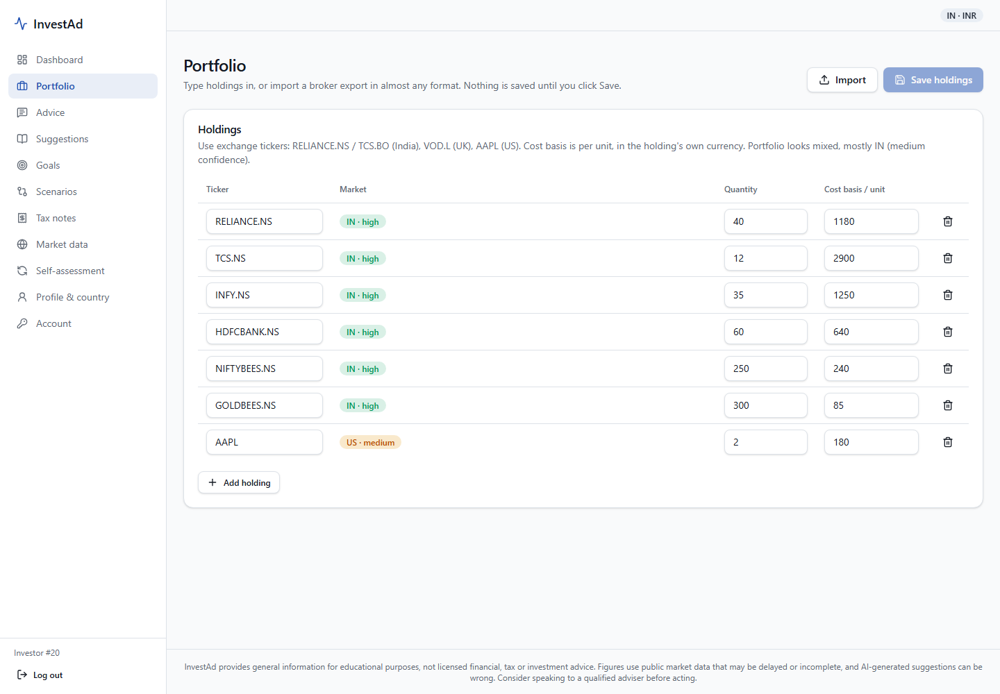
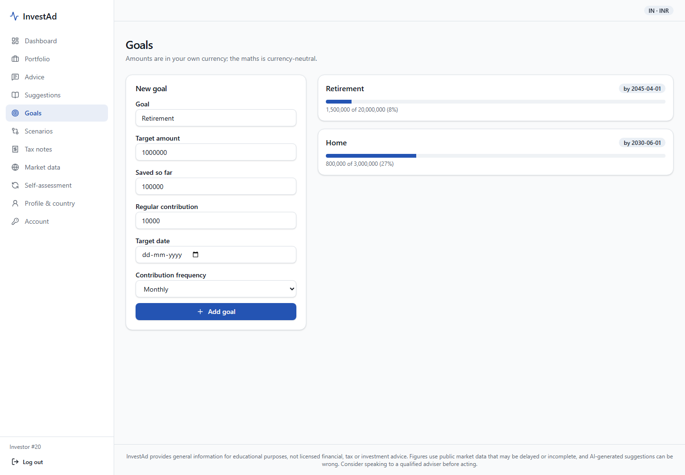
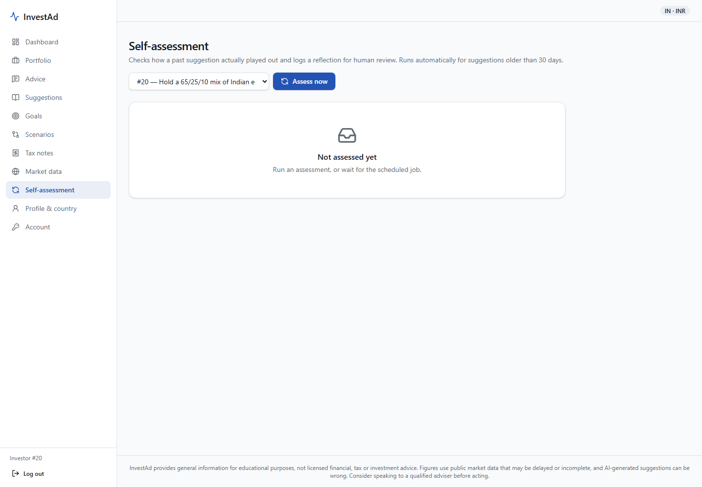

# InvestAd

[](https://github.com/chinmay2975-crypto/Investment-advisory-agent/actions/workflows/ci.yml)

InvestAd is a country-aware investment advisory agent built as a final-year project. It reads a
portfolio in almost any format and analyses it against the right market (India, US or UK). It
then produces explained suggestions with LangGraph agents. Goal probabilities come from a Monte
Carlo simulation. Later, a Reflexion-style loop checks how its past suggestions actually turned
out against the market.

> InvestAd provides general information for educational purposes, not licensed financial, tax
> or investment advice.



## Features

- **Portfolio import from almost any source:**
  - Supported inputs: CSV/TSV, Excel/ODS, JSON, PDF (including scans), Word, saved web pages,
    screenshots, or pasted text.
  - Columns are matched automatically, and every ticker is checked against market data before
    anything is saved.
- **Country-aware analysis:**
  - Each holding is measured against its own market's benchmark (Nifty 50, S&P 500, FTSE 100),
    risk-free rate and currency.
  - Metrics: return, volatility, Sharpe, beta, max drawdown and concentration (HHI).
  - Breakdowns by country, sector, asset class and currency.
  - The market is inferred from ticker suffixes (`.NS`/`.BO`, `.L`, none), and you can override it.
- **Streaming advice:**
  - The advice agent streams its stages and the sections of its suggestion over Server-Sent
    Events.
  - Each suggestion covers what to do, why, the expected behaviour and the risks.
- **Simulated goal probability:** 5,000 lognormal market paths per suggestion, using
  country-specific capital-market assumptions. The LLM's own guess is kept only for comparison.
- **Refinement chat:** a request such as "remove Apple and add more bonds" is split by the LLM
  into separate constraints. Later turns can cancel earlier constraints.
- **Scenarios:** conservative, balanced and aggressive variants side by side, each with its own
  simulated probability.
- **Self-assessment (Reflexion):**
  - 30 days after a suggestion, its real return is compared with two things: the return the
    simulation expected, and the market benchmark over the same window.
  - The LLM writes a reflection, which is stored in ChromaDB. Similar past reflections are
    retrieved as precedent for the next one.
- **Two LLM providers:**
  - Gemini and Groq alternate behind one router, with a cooldown and automatic fallback on rate
    limits or outages.
  - Images go to the provider that reads them best.
- **Accounts:**
  - JWT access and refresh tokens, plus login rate limiting.
  - Change password, password reset by e-mail, and full account deletion.
  - Changing the password revokes old sessions.

## Architecture



The Reflexion loop that grades past suggestions:



Country rules (currency, benchmark, risk-free source, tax notes, accounts and disclaimer) live in
one `CountryConfig` per country under `app/countries/`, using a strategy pattern. To add a market,
add one file and register it.

## Screenshots

| Streaming advice | Portfolio import |
|---|---|
|  |  |
| **Goals** | **Self-assessment** |
|  |  |

## Evaluation

The full tables are in [docs/evaluation.md](docs/evaluation.md). Regenerate them with
`python scripts/evaluate.py --db --live 3`.

| What | Result |
|---|---|
| Portfolio import, 8 formats × 4 header styles | Every file parsed. 100% ticker recall after verification. 145/145 quantities and costs exact |
| Country inference, 12 labelled portfolios incl. mixed | 12/12 |
| Monte Carlo vs closed-form lognormal probability | Mean absolute error 0.007. Seed std. dev. 0.006 at 5,000 paths (≈12 ms) |
| Structured LLM output (live) | Gemini 3/3, Groq 3/3 valid. Median latency 8.4 s / 2.0 s |
| Automated tests | 218 backend tests + 14 browser smoke tests, run in CI on every push |

## Quick start (Windows)

```powershell
python -m venv .venv
.venv\Scripts\pip install -r requirements-dev.txt
Copy-Item .env.example .env          # DATABASE_URL, JWT_SECRET, GEMINI_API_KEY, GROQ_API_KEY (+ FRED, NewsAPI)
.venv\Scripts\alembic upgrade head
cd frontend; npm install; cd ..

powershell -ExecutionPolicy Bypass -File scripts\start.ps1    # API :8000 + UI :5173, opens the browser
.venv\Scripts\python scripts\seed_demo.py                     # demo@investad.app / demo-investad-2026
```

- `scripts\stop.ps1` stops the servers.
- `start.ps1 -AtLogon` starts them automatically at every logon.
- Swagger UI is at http://127.0.0.1:8000/docs. In Swagger, use your e-mail as the username.
- `DATABASE_URL` uses the `postgresql+psycopg2://` scheme. Percent-encode special characters in the
  password (for example `@` becomes `%40`).
- `docker compose up -d` gives you a local Postgres on port 5433.

## Tests

```powershell
.venv\Scripts\python -m pytest -q                                     # backend; every LLM is mocked
cd frontend; npm run build                                            # typecheck + production build
$env:E2E_BASE_URL="http://localhost:5173"; .venv\Scripts\python -m pytest tests/e2e -q   # browser smoke
```

- GitHub Actions runs all three on every push, using SQLite and needing no secrets.
- After changing backend schemas, run `npm run gen:api` with the backend running. This regenerates
  the typed API client.

## Deploy

One Docker image serves the UI at `/` and the API at `/api`. Configs for Render (`render.yaml`)
and Fly.io (`fly.toml`) are included, and a GitHub Actions job keeps a free Supabase project from
pausing. See [docs/DEPLOY.md](docs/DEPLOY.md).

## Project layout

```
app/
  agents/      LangGraph graphs: advice, market_intelligence, refinement, scenario, self_assessment
  api/         FastAPI routers (REST + SSE)
  countries/   one CountryConfig per market + offline country inference
  llm/         Gemini / Groq clients behind a router with cooldown + fallback
  services/    import, analysis, goal simulation, deviation, tax, PDF export, accounts
  data/        capital-market assumptions for the simulation
  serve.py     production entry: API under /api + built UI
frontend/      Vite + React + TypeScript, Tailwind + shadcn-style UI, TanStack Query, Recharts
tests/         pytest suite; tests/e2e = Playwright smoke tests
scripts/       start/stop, seed_demo, evaluate, screenshots, check_data_sources
docs/          DEPLOY.md, evaluation.md, tech-stack.md (original design), llm-context.md
```
